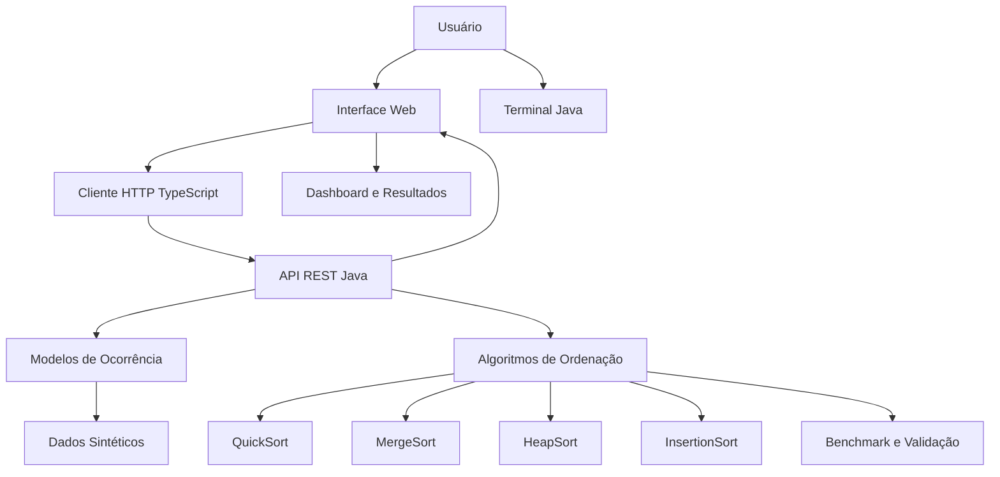

#  Sistema de Priorização de Ocorrências Policiais — COPOM / 190

**Sistema de simulação e análise de algoritmos para priorização de ocorrências policiais**, desenvolvido em Java 25 e TypeScript, com interface web interativa, execução via terminal e comparação de algoritmos de ordenação.

O projeto demonstra como algoritmos e estruturas de dados podem auxiliar na organização de grandes volumes de chamados, aplicando diferentes critérios de prioridade e analisando o desempenho computacional de cada abordagem.

> **Objetivo acadêmico:** demonstrar conceitos de algoritmos, estruturas de dados, desenvolvimento backend e frontend, comunicação HTTP e análise de desempenho em um cenário inspirado nas centrais de atendimento de emergência.

---

##  Sumário

- [1. Visão Geral e Problema do Mundo Real](#-1-visão-geral-e-problema-do-mundo-real)
- [2. Objetivos do Projeto](#-2-objetivos-do-projeto)
- [3. Arquitetura do Sistema](#-3-arquitetura-do-sistema)
- [4. Critérios de Priorização](#-4-critérios-de-priorização)
- [5. Algoritmos de Ordenação](#-5-algoritmos-de-ordenação)
- [6. Complexidade Computacional](#-6-complexidade-computacional)
- [7. Benchmark e Análise de Desempenho](#-7-benchmark-e-análise-de-desempenho)
- [8. Interface Web e Dashboard](#-8-interface-web-e-dashboard)
- [9. Tecnologias Utilizadas](#-9-tecnologias-utilizadas)
- [10. Como Executar o Projeto](#-10-como-executar-o-projeto)
- [11. Estrutura de Diretórios](#-11-estrutura-de-diretórios)
- [12. Conceitos Aplicados](#-12-conceitos-aplicados)
- [13. Considerações Finais](#-13-considerações-finais)

---

##  1. Visão Geral e Problema do Mundo Real

Centrais de atendimento de emergência, como o COPOM e o serviço 190, lidam com ocorrências de diferentes naturezas, níveis de gravidade e necessidades de resposta.

Entre os exemplos de chamados estão:

- **Ocorrências críticas:** situações com risco iminente à vida, crimes violentos e sequestros.
- **Acidentes graves:** colisões com vítimas e situações que exigem atendimento urgente.
- **Ocorrências patrimoniais:** furtos, roubos e outras infrações.
- **Ocorrências de menor gravidade:** situações que demandam atendimento, mas apresentam menor urgência relativa.

Nesse cenário, a quantidade de ocorrências pode crescer rapidamente, enquanto os recursos disponíveis para atendimento são limitados.

O desafio computacional consiste em organizar os chamados de maneira eficiente, considerando critérios como gravidade, tempo de espera, distância da viatura e concentração de ocorrências por região.

O **Sistema de Priorização de Ocorrências Policiais** foi desenvolvido para simular esse problema e comparar diferentes estratégias de ordenação, permitindo observar como as escolhas algorítmicas afetam o processamento de grandes conjuntos de dados.

###  Por que esse projeto é relevante?

- **Eficiência computacional:** compara algoritmos com diferentes complexidades de tempo e memória.
- **Priorização configurável:** permite organizar ocorrências por diferentes critérios.
- **Escalabilidade experimental:** possibilita trabalhar com massas de dados sintéticas para avaliar o comportamento dos algoritmos.
- **Integração de tecnologias:** combina uma aplicação Java com uma interface web em TypeScript.
- **Análise de desempenho:** oferece uma base para comparar tempo de execução e vazão de processamento.

---

##  2. Objetivos do Projeto

O projeto foi concebido para aplicar conhecimentos de programação e análise de algoritmos em um cenário prático.

### Objetivos principais

1. Implementar diferentes algoritmos de ordenação em Java e TypeScript.
2. Organizar ocorrências segundo critérios configuráveis de prioridade.
3. Gerar grandes volumes de dados sintéticos para testes.
4. Comparar o desempenho de algoritmos sob diferentes condições.
5. Desenvolver uma interface web para visualização e interação com os dados.
6. Implementar comunicação entre frontend e backend por meio de uma API HTTP.
7. Explorar conceitos de complexidade algorítmica, estruturas de dados e otimização.

---

##  3. Arquitetura do Sistema

O projeto utiliza uma arquitetura dividida entre backend Java e frontend TypeScript.

O backend concentra a lógica de domínio, os algoritmos de ordenação, a geração de dados e os recursos HTTP. O frontend disponibiliza a interface de interação e as visualizações no navegador.

### Visão simplificada da arquitetura



### Responsabilidades dos módulos

| Módulo | Responsabilidade |
|---|---|
| `model/` | Representação das ocorrências, critérios de priorização e regiões. |
| `sorting/` | Implementação dos algoritmos de ordenação em Java. |
| `generator/` | Geração de massas de dados sintéticas para simulação. |
| `benchmark/` | Medição de desempenho, vazão e validação dos resultados. |
| `app/ApiServer.java` | Servidor HTTP, endpoints da API e disponibilização de arquivos estáticos. |
| `app/Main.java` | Ponto de entrada da aplicação e menu interativo no terminal. |
| `frontend/src/types.ts` | Definição dos tipos e modelos utilizados pelo frontend. |
| `frontend/src/sorting.ts` | Implementações de QuickSort, MergeSort e HeapSort em TypeScript. |
| `frontend/src/api.ts` | Comunicação assíncrona com o backend e tratamento de indisponibilidade conforme a implementação. |
| `frontend/src/app.ts` | Controle da interface, visualizações gráficas e interações do dashboard. |
| `frontend/style.css` | Estilização da interface, indicadores visuais e componentes. |

---

##  4. Critérios de Priorização

O sistema contempla seis critérios de ordenação, permitindo avaliar diferentes formas de organizar uma fila de ocorrências.

### 1. Gravidade crítica — ordem decrescente

Prioriza ocorrências com maior nível de gravidade.

- Gravidade 10: prioridade superior.
- Gravidade 1: prioridade inferior dentro desse critério.

A finalidade da simulação é demonstrar como um critério de risco pode influenciar a ordem de atendimento.

### 2. Tempo de atendimento — ordem crescente

Organiza as ocorrências pelo tempo de atendimento estimado, colocando os menores valores primeiro.

Esse critério permite estudar cenários voltados à redução do tempo de processamento ou à resolução de chamados mais rápidos.

**Observação:** tempo estimado de resolução não é, por si só, um indicador de urgência ou risco à vida.

### 3. Distância da viatura — ordem crescente

Prioriza ocorrências de acordo com a distância informada entre a viatura disponível e o local do chamado.

Em condições equivalentes, uma ocorrência mais próxima pode representar uma possibilidade de resposta mais rápida. A distância isolada, porém, não determina a prioridade operacional real.

### 4. Data e hora — ordem cronológica (FIFO)

Organiza os chamados dos mais antigos para os mais recentes.

FIFO significa *First In, First Out* — primeiro a entrar, primeiro a sair.

Esse critério ajuda a visualizar o comportamento de uma fila cronológica e a identificar situações em que chamados antigos poderiam permanecer aguardando por muito tempo.

### 5. Score composto de risco

Combina múltiplas variáveis em uma pontuação numérica:

```text
Score = (Gravidade × 15) + Proximidade + Espera
```

A pontuação permite comparar ocorrências considerando mais de um atributo simultaneamente.

O peso 15 atribuído à gravidade destaca a influência desse fator na fórmula apresentada. Para uma aplicação operacional real, seria necessário definir unidades, normalização, calibração dos pesos e regras de segurança com especialistas responsáveis.

### 6. Volume por região

Considera a concentração de ocorrências em cada região para permitir a análise de áreas com maior acúmulo de chamados.

Esse critério pode apoiar experimentos de distribuição de demanda e visualização de regiões com maior volume de ocorrências simuladas.


---

##  5. Algoritmos de Ordenação

O projeto reúne algoritmos clássicos para comparar estratégias de organização de dados. Cada algoritmo possui características próprias de desempenho, consumo de memória e estabilidade.

### 5.1 QuickSort — mediana de três

O QuickSort utiliza a estratégia de divisão e conquista. Ele seleciona um pivô, particiona os elementos e ordena recursivamente as partes resultantes.

**Características:**

- Complexidade média de \(O(N \log N)\).
- Pior caso de \(O(N^2)\).
- Consumo auxiliar geralmente de \(O(\log N)\) na pilha em cenários equilibrados.
- Não é estável em sua implementação tradicional.

A estratégia de mediana de três, quando utilizada na escolha do pivô, procura reduzir a probabilidade de partições muito desequilibradas em determinadas distribuições de entrada.

**Aplicação no projeto:** estudo de ordenação eficiente e comparação com outros algoritmos.

### 5.2 MergeSort

O MergeSort também utiliza divisão e conquista, separando os dados em partes menores e intercalando os resultados ordenados.

**Características:**

- Complexidade de \(O(N \log N)\) nos casos clássico melhor, médio e pior.
- Memória auxiliar de \(O(N)\) em implementações tradicionais para vetores.
- É estável quando a intercalação preserva a ordem relativa de elementos equivalentes.

**Aplicação no projeto:** comparação de desempenho previsível e análise do custo adicional de memória.

### 5.3 HeapSort

O HeapSort utiliza uma estrutura de heap para selecionar os elementos em ordem.

**Características:**

- Complexidade de \(O(N \log N)\) no melhor, médio e pior caso.
- Memória auxiliar de \(O(1)\) em implementações iterativas *in-place*.
- Não é estável em sua implementação tradicional.

**Aplicação no projeto:** estudar uma alternativa com limite assintótico de tempo e baixo consumo de memória auxiliar.

### 5.4 InsertionSort

O InsertionSort percorre os elementos e insere cada um na posição correta dentro da parte já ordenada.

**Características:**

- Melhor caso de \(O(N)\), quando os dados já estão ordenados ou quase ordenados de forma favorável.
- Caso médio e pior caso de \(O(N^2)\).
- Memória auxiliar de \(O(1)\).
- É estável quando implementado sem trocar a ordem de elementos equivalentes.

**Aplicação no projeto:** demonstrar como algoritmos simples podem ser competitivos em conjuntos pequenos ou praticamente ordenados.

### 5.5 Java Native — TimSort

O projeto também considera o algoritmo de ordenação nativo da plataforma Java como referência de comparação.

As implementações tradicionais de ordenação de objetos de `Arrays.sort` e `List.sort` utilizam TimSort ou mecanismos relacionados à ordenação estável da plataforma.

**Características gerais do TimSort:**

- Complexidade de \(O(N \log N)\) no pior caso.
- Pode apresentar comportamento próximo de \(O(N)\) em dados já ordenados.
- É estável.
- Pode utilizar memória auxiliar adicional.

O algoritmo nativo serve como referência para avaliar implementações próprias. Para uma comparação válida, devem ser mantidos equivalentes os dados de entrada, o critério de comparação e as condições de execução.

---

##  6. Complexidade Computacional

A tabela apresenta as complexidades assintóticas típicas das implementações tradicionais desses algoritmos.

| Algoritmo | Melhor caso | Caso médio | Pior caso | Memória auxiliar típica | Estável |
|---|---:|---:|---:|---:|:---:|
| QuickSort | \(O(N \log N)\) | \(O(N \log N)\) | \(O(N^2)\) | \(O(\log N)\)* | Não |
| MergeSort | \(O(N \log N)\) | \(O(N \log N)\) | \(O(N \log N)\) | \(O(N)\)* | Sim |
| HeapSort | \(O(N \log N)\) | \(O(N \log N)\) | \(O(N \log N)\) | \(O(1)\)* | Não |
| TimSort | \(O(N)\)* | \(O(N \log N)\) | \(O(N \log N)\) | Até \(O(N)\)* | Sim |
| InsertionSort | \(O(N)\) | \(O(N^2)\) | \(O(N^2)\) | \(O(1)\) | Sim |

\* Valores típicos ou limites gerais de implementações tradicionais. A memória do QuickSort depende da estratégia de recursão; o MergeSort depende da representação dos dados; o TimSort pode aproveitar sequências ordenadas já existentes. As características exatas variam conforme a implementação.

### O que significa \(O(N \log N)\)?

A notação Big O descreve como o custo de um algoritmo cresce conforme aumenta o número de elementos processados.

- \(N\): quantidade de ocorrências.
- \(\log N\): fator associado à divisão progressiva dos dados.
- \(N \log N\): crescimento geralmente mais eficiente que \(N^2\) para grandes conjuntos de dados.

Por exemplo, ao ordenar 50.000 ocorrências, um algoritmo com complexidade média \(O(N \log N)\) tende a escalar melhor do que um algoritmo quadrático \(O(N^2)\), embora o tempo real dependa da implementação e das condições de execução.

---

##  7. Benchmark e Análise de Desempenho

O módulo `benchmark/` é dedicado à medição de desempenho e à validação dos resultados dos algoritmos.

A análise de benchmark permite observar que a eficiência não depende apenas do nome do algoritmo, mas também de fatores como distribuição dos dados, implementação, ambiente de execução e custo da função de comparação.

### Métricas de interesse

- **Tempo de execução:** duração necessária para ordenar os dados.
- **Vazão de processamento:** quantidade de elementos processados por unidade de tempo.
- **Validação da ordenação:** verificação de que os resultados respeitam o critério selecionado.
- **Consistência dos resultados:** comparação das saídas para entradas equivalentes.

### Como interpretar os resultados

| Cenário | O que observar |
|---|---|
| Conjunto pequeno | O custo de inicialização pode influenciar o tempo medido. |
| Conjunto grande | Diferenças de complexidade podem ficar mais evidentes. |
| Dados ordenados | Algoritmos adaptativos podem apresentar vantagem. |
| Dados aleatórios | Permitem comparar o comportamento em uma distribuição diferente. |
| Dados com muitos empates | Exigem atenção ao critério de desempate e à estabilidade. |

Para obter resultados reproduzíveis, recomenda-se executar várias rodadas, usar cópias equivalentes dos dados e separar o tempo de preparação do tempo efetivo de ordenação.

**Nota:** este README não apresenta tempos numéricos de benchmark, pois eles devem ser preenchidos com medições reais obtidas na execução do projeto.

---

##  8. Interface Web e Dashboard

O frontend utiliza TypeScript, HTML e CSS para disponibilizar uma interface web inspirada em um painel tático de central de operações.

### Características da interface

- **Dark Mode:** apresentação visual baseada em tons escuros.
- **Glassmorphism:** elementos de interface com aparência de superfícies sobrepostas, conforme os estilos implementados.
- **Indicadores de urgência:** recursos visuais para diferenciar níveis de prioridade.
- **KPIs:** componentes de resumo de informações.
- **Gráficos Canvas:** visualizações gráficas implementadas no frontend.
- **Integração HTTP:** comunicação assíncrona com o backend Java.
- **Fallback offline:** tratamento alternativo de indisponibilidade conforme os recursos implementados no cliente.

A interface funciona como camada de apresentação e interação, enquanto o backend disponibiliza os recursos da aplicação.

O servidor Java também é responsável por fornecer arquivos estáticos da interface, conforme a configuração do projeto.

---

##  9. Tecnologias Utilizadas

| Tecnologia | Utilização |
|---|---|
| **Java 25** | Backend, modelos de domínio, algoritmos e aplicação de terminal. |
| **TypeScript** | Lógica do frontend, tipos, algoritmos e integração com a API. |
| **HTML5** | Estrutura da interface web. |
| **CSS3** | Estilização, layout e indicadores visuais. |
| **HTTP / REST** | Comunicação entre frontend e backend. |
| **JavaScript Canvas API** | Renderização das visualizações gráficas do frontend. |
| **Node.js e npm** | Ambiente e gerenciamento de dependências do frontend. |
| **Vite** | Ferramenta de desenvolvimento e compilação web, conforme a configuração do frontend. |
| **Windows Batch (.bat)** | Automatização da compilação e execução no Windows. |
| **Git e GitHub** | Controle de versão e hospedagem do código-fonte. |

---

##  10. Como Executar o Projeto

O projeto disponibiliza scripts para facilitar a compilação e a execução em ambientes Windows.

### Pré-requisitos

Antes de iniciar, verifique se o ambiente possui:

- JDK 25 instalado.
- Node.js e npm instalados.
- Git, caso deseje clonar o repositório.
- Terminal compatível com os scripts `.bat`.

Verifique as instalações pelo terminal:

```bash
java -version
javac -version
node -v
npm -v
```

### 10.1. Obter o código-fonte

Clone o repositório:

```bash
git clone https://github.com/jhuanvcode/COPOM-Centro-de-Operacoes-Policiais-Militares
```

Entre na pasta do projeto:

```bash
cd sistema-priorizacao-ocorrencias
```

### 10.2. Executar pelo terminal

Na raiz do projeto, execute:

```bat
compilar.bat
```

Depois da compilação, inicie a aplicação:

```bat
executar.bat
```

Esses scripts correspondem aos pontos de entrada previstos para compilação e execução em modo terminal.

### 10.3. Executar a interface web

Para iniciar o servidor e abrir o dashboard no navegador, execute:

```bat
executar-web.bat
```

O script é o ponto de entrada previsto para a execução integrada da aplicação web.

### 10.4. Dependências do frontend

Se for necessário preparar o frontend manualmente, entre na pasta correspondente:

```bash
cd frontend
npm install
```

O comando `npm install` instala as dependências declaradas no `package.json`.

Os comandos adicionais de desenvolvimento ou compilação do frontend devem seguir os scripts configurados nesse arquivo.

---

##  11. Estrutura de Diretórios

```text
sistema-priorizacao-ocorrencias/
│
├── compilar.bat
├── executar.bat
├── executar-web.bat
├── README.md
│
├── bin/
│   └── Classes Java compiladas (.class)
│
├── frontend/
│   ├── index.html
│   ├── style.css
│   ├── package.json
│   ├── tsconfig.json
│   │
│   └── src/
│       ├── types.ts
│       ├── sorting.ts
│       ├── api.ts
│       └── app.ts
│
└── src/
    └── br/com/policia/
        ├── model/
        ├── sorting/
        ├── generator/
        ├── benchmark/
        │
        └── app/
            ├── ApiServer.java
            └── Main.java
```
---

##  12. Conceitos Aplicados

O desenvolvimento reúne conceitos importantes de programação, estruturas de dados e engenharia de software.

### Algoritmos e estruturas de dados

- Divisão e conquista.
- Ordenação por comparação.
- Filas e critérios de prioridade.
- Análise de complexidade temporal e espacial.
- Estabilidade de algoritmos.
- Comparação de implementações próprias e nativas.

### Backend e integração

- Programação orientada a objetos em Java.
- Modelagem de dados.
- Servidor HTTP.
- Endpoints e comunicação entre aplicações.
- Separação de responsabilidades por módulos.

### Frontend e experiência do usuário

- Tipagem estática com TypeScript.
- Comunicação assíncrona.
- Manipulação de dados e atualização de interface.
- Visualização gráfica com Canvas.
- Organização de estilos com CSS.

### Testes e desempenho

- Geração de dados sintéticos.
- Validação de resultados.
- Medição de tempo de execução.
- Comparação entre estratégias algorítmicas.
- Análise de escalabilidade.

---

## 🏁 13. Considerações Finais

O **Sistema de Priorização de Ocorrências Policiais — COPOM / 190** demonstra como conceitos teóricos de algoritmos podem ser aplicados a um problema de organização e classificação de informações.

Ao combinar Java, TypeScript, algoritmos de ordenação, benchmark e interface web, o projeto oferece uma base prática para estudar desempenho computacional e integração entre aplicações.

**Principais áreas de conhecimento demonstradas:**

- Desenvolvimento Java.
- Desenvolvimento web com TypeScript.
- Algoritmos e estruturas de dados.
- Análise de complexidade computacional.
- Benchmark e validação.
- APIs HTTP.
- Organização modular de software.
- Visualização de dados.

---

###  Aviso de uso

Este projeto tem finalidade exclusivamente educacional e demonstrativa. Os dados utilizados para simulação não devem ser interpretados como registros oficiais. O sistema não é homologado para uso operacional por forças de segurança pública e não substitui protocolos oficiais de triagem, avaliação de risco ou despacho de recursos de emergência.

---

**Desenvolvido para fins acadêmicos e de estudo em programação, algoritmos e engenharia de software.**
